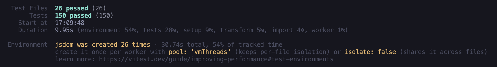
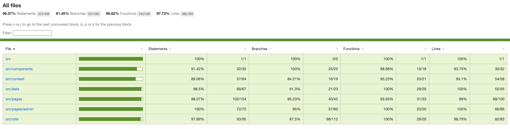

# Documento de cobertura de testing - Florae React

- **Asignatura:** DSY1104 Desarrollo Fullstack II, Duoc UC
- **Evaluación:** Parcial 2 - Implementando frontend y pruebas unitarias a mi tienda online
- **Autora:** Daniela Cuevas
- **Repositorio:** https://github.com/danielacuevasd/plant-ecommerce-r
- **Sitio publicado:** https://plant-ecommerce-r.vercel.app/

---

## 1. Introducción y objetivo

Este documento describe el proceso de pruebas unitarias del frontend de Florae, la tienda online de plantas migrada a React en la Evaluación Parcial 2. Su objetivo es validar el alcance de los elementos cubiertos por las pruebas: qué se probó, con qué herramientas, cómo se probó y qué quedó fuera, con el análisis de cada caso.

Resultado general de la última ejecución:

| Indicador | Resultado |
|---|---|
| Archivos de prueba | 26 (todos pasan) |
| Pruebas unitarias | 150 (todas pasan) |
| Tiempo de ejecución | 6,86 s |
| Cobertura de sentencias | 96,57 % |
| Cobertura de ramas | 91,45 % |
| Cobertura de funciones | 96,62 % |
| Cobertura de líneas | 97,72 % |

La evaluación exige como mínimo diez pruebas y al menos una de cada tipo (renderizado, renderizado condicional, props, estado y eventos). El proyecto supera ese mínimo: tiene 150 pruebas, con varios ejemplos de cada tipo (sección 5).

## 2. Entorno y herramientas

| Herramienta | Uso |
|---|---|
| Vitest (v5.0.3) | Ejecutor de pruebas, integrado con Vite |
| jsdom | Simula un navegador, para renderizar componentes sin abrir uno |
| React Testing Library | Renderiza componentes y los consulta como lo haría un usuario (por rol, etiqueta y texto) |
| @testing-library/user-event | Simula escritura, clics y selección de opciones |
| @testing-library/jest-dom | Comprobaciones específicas del DOM, como `toBeInTheDocument()` y `toBeDisabled()` |
| @vitest/coverage-v8 | Genera el reporte de cobertura con el motor V8 |

### 2.1 Configuración (`vite.config.js`)

```js
test: {
  environment: "jsdom",
  globals: true,
  setupFiles: "./src/setupTests.js",
  css: false,
  coverage: {
    provider: "v8",
    reporter: ["text", "html"],
    include: ["src/**/*.{js,jsx}"],
    exclude: ["src/main.jsx", "src/setupTests.js", "src/__tests__/**"]
  }
}
```

- `environment: "jsdom"`: las pruebas de componentes necesitan un DOM.
- `globals: true`: permite usar `describe`, `it` y `expect` sin importarlos en cada archivo.
- `css: false`: no procesa estilos durante las pruebas, lo que las hace más rápidas (consecuencia en la sección 8).
- La cobertura mide solo el código de la aplicación. Se excluyen el punto de entrada (`main.jsx`), el archivo de configuración de pruebas y las propias pruebas.

### 2.2 Archivo de preparación (`src/setupTests.js`)

Se ejecuta antes de cada prueba y hace tres cosas:
- Registra las comprobaciones de `jest-dom`.
- Limpia `localStorage` antes de cada prueba, para que ninguna dependa del estado que dejó otra. Esto es importante porque la fuente de datos simulada guarda todo allí.
- Desmonta los componentes renderizados después de cada prueba.

### 2.3 Ayudante de renderizado (`src/__tests__/utils.jsx`)

La función `renderConProveedores` renderiza un componente dentro de un `MemoryRouter` y de los proveedores de contexto reales (`AuthProvider` y `CartProvider`), igual que en la aplicación. Permite probar componentes que usan rutas, sesión o carrito, y arrancar en cualquier ruta (por ejemplo `/productos/1`).

### 2.4 Comandos

```bash
npm test           # ejecuta todas las pruebas una vez
npm run test:watch # modo observador, vuelve a ejecutar al guardar
npm run coverage   # pruebas más reporte de cobertura (carpeta coverage/)
```

## 3. Estrategia de pruebas

Las pruebas se organizan en dos capas:

| Capa | Archivos | Pruebas | Qué verifica |
|---|---|---|---|
| Lógica pura | 7 | 65 | Funciones sin interfaz: validaciones, reducer del carrito, filtros, formato de precios, regiones y fuente de datos |
| Componentes y páginas | 19 | 85 | Lo que ve y hace el usuario: renderizado, formularios, navegación, carrito y panel de administración |

**Criterio de diseño.** La lógica se separó de la interfaz a propósito. Por ejemplo, el carrito se implementa como una función pura (`carritoReducer`) que no lee `localStorage` ni la base de datos, y por eso se prueba sin renderizar nada ni usar mocks. Las páginas solo conectan esa lógica con la interfaz.

**Pruebas primero en la lógica pura.** Para las validaciones, la fuente de datos (`db.js`), el reducer del carrito, los filtros, el formato de precios y las regiones, cada pieza se desarrolló con el ciclo rojo-verde: primero un commit `test:` con pruebas que fallan, y después un commit `feat:` con la implementación. El historial de commits del repositorio lo evidencia.

**Pruebas junto al componente en la interfaz.** Para los componentes se escribió primero el componente, se comprobó en el navegador y a continuación se escribieron sus pruebas en el mismo paso, porque probar un componente que aún no existe obliga a adivinar su estructura.

## 4. Inventario de pruebas

### 4.1 Lógica pura (65 pruebas)

| Archivo | Pruebas | Qué cubre |
|---|---|---|
| `validaciones.test.js` | 28 | RUN (módulo 11), correo y dominios permitidos, contraseña, login, registro, contacto, producto y usuario del admin |
| `carritoReducer.test.js` | 10 | Agregar, cambiar cantidad, eliminar, cupón, vaciar, tope de stock y cálculo de totales |
| `usuarios.test.js` | 7 | CRUD de usuarios, correos repetidos y autenticación |
| `filtros.test.js` | 7 | Filtro por texto, por categoría y combinados |
| `db.test.js` | 6 | CRUD de productos, datos corruptos, stock crítico y persistencia |
| `formato.test.js` | 4 | Formato de precios en pesos chilenos |
| `regiones.test.js` | 3 | Comunas por región |

### 4.2 Componentes y páginas (85 pruebas)

| Archivo | Pruebas | Qué cubre |
|---|---|---|
| `Carrito.test.jsx` | 9 | Carrito vacío, totales, cantidades, eliminar, cupones y botón Pagar |
| `AdminUsuarioForm.test.jsx` | 7 | Alta y edición de usuarios, comunas por región, correos duplicados |
| `Registro.test.jsx` | 6 | Validación, comunas por región, correo duplicado y alta con inicio de sesión |
| `DetalleProducto.test.jsx` | 6 | Datos de la ruta, producto inexistente, relacionados, cantidad y tope de stock |
| `AdminProductoForm.test.jsx` | 5 | Alta y edición de productos, validación y producto inexistente |
| `Login.test.jsx` | 5 | Validación, credenciales incorrectas, sesión y redirección por rol |
| `Contacto.test.jsx` | 5 | Contador de caracteres, campos obligatorios, dominio del correo y confirmación |
| `CartItem.test.jsx` | 5 | Props, botones de cantidad, tope de stock y eliminar |
| `ProductCard.test.jsx` | 4 | Props, clic, cambio de estado del botón y producto sin stock |
| `Productos.test.jsx` | 4 | Catálogo, búsqueda, filtro por categoría y agregar al carrito |
| `AdminProductos.test.jsx` | 4 | Listado, eliminación con confirmación y lista vacía |
| `AdminUsuarios.test.jsx` | 4 | Listado, eliminación con confirmación y cuenta propia protegida |
| `CampoFormulario.test.jsx` | 4 | Etiqueta, error condicional, eventos y modo select |
| `Header.test.jsx` | 4 | Contador del carrito, panel admin según rol y menú responsivo |
| `AdminLayout.test.jsx` | 4 | Acceso al panel según sesión y totales del inicio |
| `Home.test.jsx` | 3 | Portada, destacados y agregar al carrito |
| `App.test.jsx` | 2 | Ruta inicial y página 404 |
| `Nosotros.test.jsx` | 2 | Contenido y ruta |
| `ProductList.test.jsx` | 2 | Una tarjeta por producto y lista vacía |

## 5. Pruebas por tipo (requisito de la evaluación)

La evaluación pide una prueba de cada tipo como mínimo. Ejemplos reales del proyecto:

| Tipo | Ejemplo (archivo > prueba) | Qué comprueba |
|---|---|---|
| Renderizado correcto | `ProductList` > renderiza una tarjeta por cada producto del conjunto de datos | Una tarjeta por cada producto de los datos |
| Renderizado correcto | `Productos` > muestra el catálogo completo al inicio | Los 8 productos del catálogo |
| Renderizado condicional | `CampoFormulario` > muestra el error solo cuando se recibe por props | El mensaje de error aparece solo si hay error |
| Renderizado condicional | `Login` > no muestra errores hasta que se envía el formulario | Sin errores al inicio, con errores al enviar vacío |
| Renderizado condicional | `AdminUsuarios` > no permite eliminar la cuenta con la que se inició sesión | Botón deshabilitado solo en la cuenta propia |
| Props | `ProductCard` > muestra nombre, precio e imagen recibidos por props | El componente usa los datos que recibe |
| Props | `CartItem` > muestra nombre, precio, cantidad y subtotal recibidos por props | Idem para el carrito |
| Estado | `Contacto` > el contador de caracteres cambia mientras se escribe | El estado del formulario cambia al escribir |
| Estado | `Registro` > las comunas dependen de la región seleccionada | Un cambio de estado actualiza otro campo |
| Estado | `ProductCard` > cambia el texto del botón a Agregado después del clic | Estado interno del componente |
| Eventos | `ProductCard` > llama a onAgregar con el id del producto al hacer clic | Un clic ejecuta la función con el argumento correcto |
| Eventos | `CartItem` > el botón + pide aumentar la cantidad en uno | Un clic llama a `onCambiar(id, cantidad + 1)` |
| Eventos | `Carrito` > los botones + y - cambian la cantidad y el total | Clics que cambian el estado y el total mostrado |

Las 150 pruebas incluyen además pruebas de flujo completo (por ejemplo, un registro válido que crea el usuario, inicia sesión y redirige a la tienda).

## 6. Uso de mocks

Un mock reemplaza una dependencia del navegador o una función del código con un sustituto controlado, para probar un comportamiento de forma aislada y repetible.

| Técnica | Dónde se usa | Para qué |
|---|---|---|
| `vi.fn()` | `ProductCard`, `CartItem` | Reemplaza las funciones que recibe el componente por props (`onAgregar`, `onCambiar`, `onEliminar`) y permite comprobar que se llamaron y con qué argumentos |
| `vi.spyOn(window, "confirm")` | `AdminProductos`, `AdminUsuarios` | El navegador real pregunta al usuario antes de eliminar, pero en las pruebas no hay nadie que responda. El mock simula la respuesta (aceptar o cancelar) y permite comprobar el texto del mensaje |
| `vi.spyOn(Storage.prototype, "setItem")` | `db.test.js` | Observa las escrituras en `localStorage` para comprobar que los cambios se persisten, sin modificar el código |
| Sesión y carrito simulados en `localStorage` | `Header`, `Carrito`, `AdminLayout`, `AdminUsuarios` | Se prepara el estado de partida escribiendo en `localStorage` antes de renderizar, en vez de repetir el flujo de inicio de sesión |
| `MemoryRouter` | Todas las pruebas con rutas | Simula la navegación sin un navegador real, y permite iniciar en cualquier ruta |

Después de cada prueba que usa `vi.spyOn`, se llama a `vi.restoreAllMocks()` en `afterEach`, para que un mock no afecte a la prueba siguiente.

## 7. Resultados y análisis de cobertura

### 7.1 Resultado por carpeta

| Carpeta | Sentencias | Ramas | Funciones | Líneas |
|---|---|---|---|---|
| **Todo el proyecto** | **96,57 %** | **91,45 %** | **96,62 %** | **97,72 %** |
| `src` | 100 % | 100 % | 100 % | 100 % |
| `src/components` | 91,42 % | 100 % | 88,88 % | 93,75 % |
| `src/context` | 89,06 % | 84,21 % | 95,23 % | 93,10 % |
| `src/data` | 98,50 % | 91,30 % | 100 % | 100 % |
| `src/pages` | 98,07 % | 95,23 % | 93,93 % | 98,00 % |
| `src/pages/admin` | 100 % | 95,00 % | 100 % | 100 % |
| `src/utils` | 97,89 % | 87,50 % | 100 % | 98,79 % |

### 7.2 Resultado por archivo

| Archivo | Sentencias | Ramas | Funciones | Líneas |
|---|---|---|---|---|
| `App.jsx` | 100 % | 100 % | 100 % | 100 % |
| `AdminLayout.jsx` | 100 % | 100 % | 100 % | 100 % |
| `CampoFormulario.jsx` | 100 % | 100 % | 100 % | 100 % |
| `CartItem.jsx` | 100 % | 100 % | 100 % | 100 % |
| `Footer.jsx` | 100 % | 100 % | 100 % | 100 % |
| `Header.jsx` | 75 % | 100 % | 66,66 % | 75 % |
| `ProductCard.jsx` | 91,66 % | 100 % | 80 % | 100 % |
| `ProductList.jsx` | 100 % | 100 % | 100 % | 100 % |
| `StoreLayout.jsx` | 100 % | 100 % | 100 % | 100 % |
| `AuthContext.jsx` | 85,18 % | 87,5 % | 87,5 % | 88 % |
| `CartContext.jsx` | 91,89 % | 81,81 % | 100 % | 96,96 % |
| `categorias.js` | 100 % | 100 % | 100 % | 100 % |
| `db.js` | 98,38 % | 90,47 % | 100 % | 100 % |
| `regiones.js` | 100 % | 100 % | 100 % | 100 % |
| `Carrito.jsx` | 100 % | 100 % | 100 % | 100 % |
| `Contacto.jsx` | 100 % | 100 % | 100 % | 100 % |
| `DetalleProducto.jsx` | 93,75 % | 80 % | 80 % | 93,75 % |
| `Home.jsx` | 100 % | 100 % | 100 % | 100 % |
| `Login.jsx` | 100 % | 100 % | 100 % | 100 % |
| `NoEncontrado.jsx` | 100 % | 100 % | 100 % | 100 % |
| `Nosotros.jsx` | 100 % | 100 % | 100 % | 100 % |
| `Productos.jsx` | 91,66 % | 100 % | 85,71 % | 91,66 % |
| `Registro.jsx` | 100 % | 100 % | 100 % | 100 % |
| `AdminInicio.jsx` | 100 % | 100 % | 100 % | 100 % |
| `AdminProductoForm.jsx` | 100 % | 88,46 % | 100 % | 100 % |
| `AdminProductos.jsx` | 100 % | 100 % | 100 % | 100 % |
| `AdminUsuarioForm.jsx` | 100 % | 100 % | 100 % | 100 % |
| `AdminUsuarios.jsx` | 100 % | 100 % | 100 % | 100 % |
| `carritoReducer.js` | 96,42 % | 85 % | 100 % | 95,83 % |
| `filtros.js` | 100 % | 91,66 % | 100 % | 100 % |
| `formato.js` | 100 % | 100 % | 100 % | 100 % |
| `validaciones.js` | 98,33 % | 87,5 % | 100 % | 100 % |

### 7.3 Qué está bien cubierto

- **Toda la lógica de negocio:** validaciones, reducer del carrito, filtros, formato y fuente de datos superan el 97 % de sentencias, y las funciones están cubiertas al 100 %.
- **Los formularios y el panel de administración:** login, registro, contacto, formularios de producto y usuario, y los listados del admin tienen sus líneas cubiertas al 100 %.
- **Las reglas de acceso:** las rutas del admin se prueban con tres casos (sin sesión, cliente y administrador), y la regla de no eliminar la cuenta propia tiene una prueba por cada lado.

### 7.4 Qué no está cubierto y por qué

| Archivo | Lo no cubierto | Motivo |
|---|---|---|
| `Header.jsx` | La función de cierre de sesión (líneas 13-14) | El botón "Cerrar sesión" no tiene una prueba propia. Es el hueco funcional más claro del proyecto |
| `AuthContext.jsx` | Cierre de sesión (líneas 57-58) y lectura de una sesión corrupta (línea 13) | Misma causa: el cierre de sesión no se prueba; el dato corrupto es un caso poco probable |
| `CartContext.jsx` | Lectura de un carrito corrupto en `localStorage` (línea 19) | Es una protección ante datos dañados y se probó el caso equivalente en `db.js` |
| `ProductCard.jsx` | El temporizador que vuelve el botón de "Agregado" a "Añadir al carrito" tras 1,2 s | Las pruebas no avanzan el tiempo. Se podría cubrir con temporizadores simulados de Vitest (`vi.useFakeTimers`) |
| `DetalleProducto.jsx` | El botón de agregar de los productos relacionados y el mensaje de "sin relacionados" (línea 76) | Las pruebas cubren el botón principal de la página; el de las tarjetas relacionadas es el mismo componente `ProductCard`, ya probado |
| `Productos.jsx` | El manejador del envío del formulario de búsqueda (línea 29) | Solo evita que la página se recargue si el usuario presiona Enter |
| `AdminProductoForm.jsx` | Valores por defecto al precargar un producto sin descripción, stock crítico o imagen (líneas 23-28) | Ramas alternativas de datos opcionales |
| `carritoReducer.js` | La rama `default` del reducer (línea 53) | Se ejecuta solo con una acción desconocida, que la aplicación nunca envía |
| `filtros.js`, `db.js`, `validaciones.js` | Ramas secundarias (valores por defecto y límites de longitud de campos auxiliares) | Casos poco frecuentes dentro de funciones cuyo comportamiento principal está cubierto. El detalle exacto de cada línea está en el reporte HTML (`coverage/index.html`) |

### 7.5 Cómo leer los porcentajes

- **Sentencias y líneas:** qué parte del código se ejecutó durante las pruebas.
- **Ramas:** qué parte de las decisiones (`if`, `?:`, `&&`, `||`) se recorrió por ambos caminos. Es la métrica más baja (91,45 %) porque los caminos alternativos son los más difíciles de provocar.
- **Funciones:** qué parte de las funciones se llamó al menos una vez.

Una cobertura alta indica que el código se ejecuta durante las pruebas, pero no garantiza que las pruebas verifiquen lo correcto. Por eso las pruebas de este proyecto no solo ejecutan el código: comprueban resultados concretos (textos, valores guardados, rutas y estados de los controles).

## 8. Hallazgos del proceso de pruebas

Las pruebas permitieron detectar y corregir problemas reales durante el desarrollo:

1. **RUN de ejemplo inválidos heredados de la EP1.** Al escribir la prueba "los usuarios semilla tienen RUN válido" se comprobó que los tres usuarios de ejemplo tenían un dígito verificador incorrecto, y el formulario de edición del admin los habría rechazado. Se corrigieron los datos.
2. **Tope de stock en el detalle de producto.** Una prueba que intentaba agregar 50 unidades de un producto con stock 12 falló, porque el atributo `max` del campo bloquea el envío del formulario antes de llegar al carrito. Se entendió que el tope tiene dos capas: el atributo `max` avisa al usuario en el momento, y el reducer del carrito garantiza que nunca se supere el stock. La prueba se rehízo para verificar la segunda capa, que es la que no se puede saltar.
3. **Correo del formulario de contacto.** En la EP1 el correo era opcional. Se decidió hacerlo obligatorio, porque el formulario promete una respuesta. El cambio se hizo con el mismo ciclo: primero se actualizaron las pruebas (fallaron), después el código (pasaron).
4. **Cuenta propia en el panel de usuarios.** Se agregó la regla de que un administrador no puede eliminar su propia cuenta, con una prueba para cada caso (cuenta propia y cuenta ajena).

## 9. Limitaciones y trabajo futuro

- **Diseño responsivo:** Vitest se ejecuta con `css: false` y jsdom no calcula estilos, así que las pruebas no verifican el aspecto en distintos tamaños de pantalla. Solo se prueba el comportamiento del menú móvil (el estado `aria-expanded` del botón). El diseño responsivo se verificó manualmente, con las herramientas del navegador y en el sitio publicado.
- **Pruebas de extremo a extremo:** no hay pruebas con un navegador real (por ejemplo con Playwright o Cypress). jsdom es una simulación y puede diferir de un navegador en detalles.
- **Cierre de sesión sin prueba:** es el hueco funcional más claro (sección 7.4) y la primera mejora recomendada.
- **Temporizadores:** pendiente usar `vi.useFakeTimers` para cubrir el retorno del botón "Agregado".
- **Datos simulados:** la base de datos es `localStorage`, y las contraseñas se guardan en texto plano. Es adecuado para esta etapa sin backend. Cuando exista un servidor, las pruebas de `db.js` se reemplazarán por pruebas de la capa de acceso a la API, con mocks de las peticiones.
- **Funcionalidades fuera de alcance:** el flujo de checkout con páginas de compra exitosa y pago fallido, y la gestión de órdenes en el admin, son opcionales en las instrucciones y no se implementaron, por lo que no tienen pruebas.
- **Mantenimiento del documento:** las cifras corresponden a la última ejecución (150 pruebas, 26 archivos). Si se agregan pruebas, hay que volver a ejecutar `npm run coverage` y actualizar este documento.

## 10. Cómo reproducir los resultados

```bash
git clone https://github.com/danielacuevasd/plant-ecommerce-r.git
cd plant-ecommerce-r
npm install
npm run coverage
```

Al terminar, la tabla de cobertura aparece en la terminal y el reporte navegable queda en `coverage/index.html`. Allí se puede entrar a cada archivo y ver las líneas no cubiertas marcadas en rojo.


### Evidencia de la última ejecución



